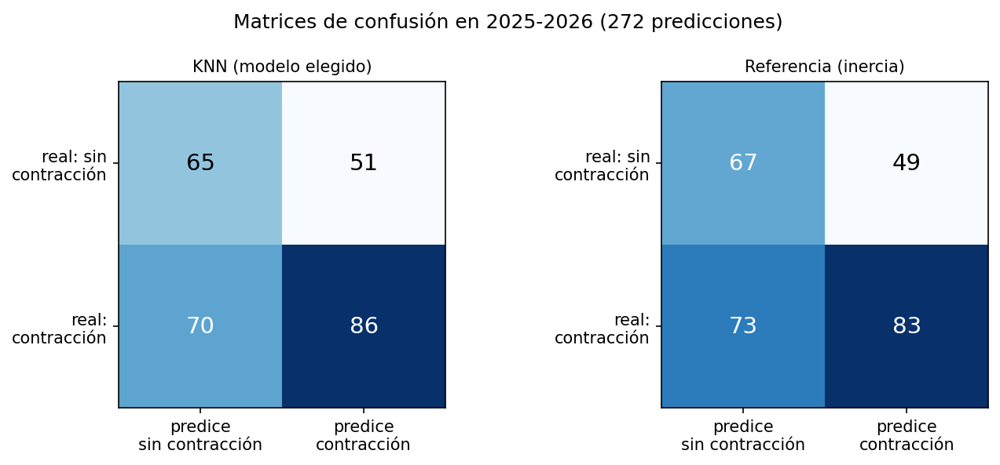

# Predicción de contracción interanual en la industria manufacturera argentina: un modelo de clasificación bajo disponibilidad real de información

**Proyecto de Aprendizaje Automático** · Tecnicatura Superior en Ciencia de Datos e Inteligencia Artificial
**Alumna:** Mónica Frías · **Docente:** Nicolás Caballero · 2026

## Resumen

Para cada una de las 16 divisiones de la industria manufacturera argentina, el proyecto intenta predecir si va a estar en **contracción interanual 3 meses después del momento de la predicción**. Usa solo información pública ya publicada en ese momento:
- la evolución reciente de la propia división;
- la capacidad instalada;
- el tipo de cambio;
- la tasa BADLAR;
- la balanza comercial.

Se compararon cinco modelos de clasificación (regresión logística, KNN, árbol de decisión, Random Forest y Gradient Boosting) con validación temporal, sin fuga de información. Se contrastaron con una referencia de inercia ("la división seguirá como en el último dato").

El modelo elegido por validación, **KNN con k = 15**, detectó en 2025-2026 el **55%** de las contracciones, con un **63%** de alertas correctas. Es un desempeño **prácticamente igual al de la referencia**: con estas variables, anticipar los cambios de ciclo con 3 meses de horizonte resultó muy difícil. El repositorio incluye el modelo listo para usar y sus predicciones para los meses cuyo resultado todavía no se publicó.

**Cómo recorrer el proyecto:**
1. Este README: definición del problema, resultados y conclusiones.
2. [`docs/01_datos_y_exploracion.md`](docs/01_datos_y_exploracion.md): origen de los datos, preparación y análisis exploratorio.
3. [`docs/diccionario_de_datos.md`](docs/diccionario_de_datos.md): todas las variables de todos los archivos.
4. [`notebooks/1.0-mf-carga-exploracion-dataset.ipynb`](notebooks/1.0-mf-carga-exploracion-dataset.ipynb): carga, transformaciones y exploración.
5. [`notebooks/2.0-mf-modelado-evaluacion.ipynb`](notebooks/2.0-mf-modelado-evaluacion.ipynb): modelos, evaluación, interpretación y uso.
6. [`docs/02_modelo_y_resultados.md`](docs/02_modelo_y_resultados.md): detalle del modelo y de los resultados.
7. [Video de presentación](#video-de-presentación), al final de este README.

---

## 1. Contexto y relevancia

La industria manufacturera es uno de los sectores que más empleo formal genera en Argentina y uno de los más sensibles a los cambios en la economía. La demanda interna, el tipo de cambio, el costo del financiamiento y la competencia de los productos importados afectan de forma distinta a cada rama de actividad: un mismo contexto puede favorecer a unas y perjudicar a otras.

En 2026 la situación fue muy cambiante. Según el INDEC, el índice de producción industrial manufacturero cayó 5,7% en mayo y subió 2,0% en junio. Las ramas tampoco se comportan igual. En agosto de 2026, 11 de las 16 divisiones produjeron menos que en agosto de 2025. Las caídas más fuertes fueron:
- Maquinaria y equipo: −24%;
- Otros equipos, aparatos e instrumentos: −21%;
- Prendas de vestir, cuero y calzado: −15%.

En cambio, Otro equipo de transporte creció 12%.

Anticipar qué ramas van a estar en contracción en los próximos meses es útil para empresas, cámaras sectoriales y organismos públicos que necesitan planificar con tiempo la producción, las compras, el empleo, el financiamiento o las políticas de apoyo sectorial.

## 2. Problema

Para cada rama de la industria y cada mes, predecir si esa rama va a estar en contracción interanual 3 meses después del momento de la predicción. La predicción se hace con la información disponible en ese momento:
- los factores económicos que influyen sobre la industria (capacidad instalada, tipo de cambio, tasa de interés y comercio exterior);
- como complemento, la evolución reciente de la propia rama.

| Definición | En este proyecto |
|---|---|
| **Unidad de análisis** (qué es una fila) | Una división de la industria manufacturera (16, según la CLaNAE 2004) en un mes *t* |
| **Población y alcance** | Las 16 divisiones del IPI manufacturero del INDEC, de 2017 a 2026 |
| **Momento de la predicción** | El mes *t+2*, cuando el INDEC publica el IPI del mes *t*. En ese momento ya están publicados el tipo de cambio, la tasa y la balanza comercial de *t*, y la capacidad instalada de *t-1*. |
| **Horizonte** | 3 meses: se predice el mes *t+5*. El resultado se conoce en *t+7*, cuando se publica su IPI. |
| **Variable objetivo** | 1 si el IPI de la división en *t+5* es menor que en *t-7* (el mismo mes del año anterior), 0 si no |
| **Uso previsto** | Alerta temprana para priorizar el seguimiento de las divisiones con más riesgo. Un falso negativo es una contracción no anticipada; un falso positivo, una alerta que no se cumplió. |

Ejemplo: con el dato de diciembre de 2024, publicado en febrero de 2025, se predice si mayo de 2025 estará por debajo de mayo de 2024. El resultado se conoce en julio de 2025.

## 3. Objetivos

**Objetivo general.** Desarrollar un modelo de aprendizaje automático que anticipe, con 3 meses de horizonte desde el momento de la predicción, si cada una de las 16 divisiones de la industria manufacturera argentina va a presentar una caída interanual de su producción. El modelo se basa en factores económicos que influyen sobre la industria y en la evolución reciente de cada rama.

**Objetivos específicos:**
1. Integrar en una única base mensual, por división, la producción industrial y las variables explicativas, usando para cada mes solo información que ya estaba publicada en ese momento.
2. Explorar la relación de las variables predictoras con la variable objetivo y evaluar su aporte predictivo, con decisiones tomadas solo dentro del período de entrenamiento.
3. Describir cómo evolucionó la producción de cada división desde 2016 e identificar períodos de expansión y contracción.
4. Entrenar distintos modelos de clasificación, elegir sus hiperparámetros con validación temporal y compararlos con modelos de referencia simples.
5. Evaluar si el modelo anticipa la situación de 2025-2026 a partir de lo aprendido en años anteriores, interpretar qué variables pesan más y mostrar cómo se usa para predecir casos nuevos.

## 4. Tipo de problema: clasificación binaria

El modelo no predice cuánto va a producir una rama, que sería regresión. Predice si va a estar en contracción o no: dos categorías. La regla "IPI(*t+5*) < IPI(*t-7*)" solo **define la etiqueta**. En el momento de la predicción, el IPI de *t+5* todavía no existe. Lo que el modelo aprende de los casos históricos es la relación entre las condiciones de un mes y el resultado de la rama 3 meses después de la decisión.

Las clases están equilibradas en el total (54,9% de contracción en las 1.728 filas modelables), pero la proporción cambia muchísimo entre años: del 18% (2021) al 94% (2018). Por eso, además de la exactitud, se analizan la **exactitud balanceada**, la precisión, el recall, el F1 y el AUC.

## 5. Datos

Datos reales y públicos, de frecuencia mensual. Se guardan sin modificar en [`data/raw/`](data/raw), con sus enlaces y fechas de descarga en [`docs/01_datos_y_exploracion.md`](docs/01_datos_y_exploracion.md).

| Fuente | Datos | Variables que se construyen |
|---|---|---|
| INDEC | Índice de producción industrial manufacturero (IPI) por división | Variable objetivo; variación interanual actual y de los dos meses anteriores; aceleración; contracción actual |
| INDEC | Utilización de la capacidad instalada (nivel general y 12 bloques) | Nivel y diferencia interanual, del bloque de cada división y del nivel general (con un mes de rezago) |
| BCRA | Tipo de cambio mayorista de referencia (Com. A 3500) | Variación interanual y de 3 meses |
| BCRA | Tasa BADLAR de bancos privados | Nivel y diferencia interanual |
| INDEC | Balanza comercial | Variación interanual de exportaciones e importaciones |

La tabla de modelado ([`data/processed/tabla_modelo.csv`](data/processed/tabla_modelo.csv)) tiene **2.048 filas** (16 divisiones × 128 meses) y 24 columnas. **15 son predictoras.** Se excluyeron los primeros 3 meses de 2017 (48 filas), que no tienen historia suficiente para calcular las variables, sin imputar valores. El significado, el tipo, la unidad y la fuente de cada variable, incluidas las de los archivos originales que no se usan, están en el [**diccionario de datos**](docs/diccionario_de_datos.md).

## 6. Metodología

1. **Separación temporal**, sin repartir un mes entre conjuntos:
   - **entrenamiento:** filas cuyo resultado se conocía antes de enero de 2025 (datos de abril 2017 a mayo 2024, 1.376 filas);
   - **evaluación final:** predicciones de 2025-2026 (272 filas);
   - **pendientes:** filas cuyo resultado todavía no se publicó (80).
2. **Validación temporal** dentro del entrenamiento, con 4 cortes (enero 2021, 2022, 2023 y 2024): en cada uno se entrena con el pasado y se valida con el año siguiente.
3. **Búsqueda de hiperparámetros** (110 configuraciones de los 5 modelos), con la **exactitud balanceada** como criterio. El escalado y la ponderación de clases forman parte de cada configuración, y el escalado se ajusta solo con el entrenamiento de cada corte.
4. **Evaluación final una sola vez** en 2025-2026, con cada modelo ya configurado.
5. **Modelo de uso:** el modelo elegido se reentrena con todos los resultados conocidos y predice los casos pendientes.

## 7. Resultados principales

Evaluación final en 2025-2026: 272 predicciones, 156 contracciones reales. La clase positiva es contracción.

| Modelo | Exactitud balanceada | Precisión | Recall | F1 | AUC |
|---|---|---|---|---|---|
| **KNN, k = 15 (elegido por validación)** | **0,556** | 0,628 | 0,551 | 0,587 | 0,572 |
| Regresión logística | 0,602 | 0,923 | 0,231 | 0,369 | 0,664 |
| Gradient Boosting | 0,569 | 0,655 | 0,474 | 0,550 | 0,604 |
| Árbol de decisión | 0,469 | 0,312 | 0,032 | 0,058 | 0,536 |
| Random Forest | 0,445 | 0,167 | 0,019 | 0,034 | 0,486 |
| Referencia (inercia) | 0,555 | 0,629 | 0,532 | 0,576 | — |
| Clase mayoritaria (siempre "contracción") | 0,500 | 0,574 | 1,000 | 0,729 | — |



El modelo elegido **detectó 86 de las 156 contracciones** y emitió **51 falsas alarmas**. La referencia detectó 83, con 49 falsas alarmas. El detalle, la interpretación y un caso explicado paso a paso están en [`docs/02_modelo_y_resultados.md`](docs/02_modelo_y_resultados.md).

## 8. Conclusiones

- **El modelo no supera de forma clara a la referencia de inercia.** Con estas variables y 3 meses de horizonte desde la decisión, la evidencia no permite afirmar que el modelo anticipe mejor que suponer que cada división seguirá como en el último dato publicado.
- **La dificultad está en los cambios de ciclo.** Ni el modelo ni la referencia anticiparon el giro de mediados de 2025, cuando la proporción de contracciones pasó del 10% al 60-73%. En los períodos estables, ambos aciertan alrededor del 70%.
- **Las métricas engañosas se detectaron.** Un clasificador que dice siempre "contracción" tiene el F1 más alto (0,729) sin anticipar nada. Por eso se eligió con exactitud balanceada y se compararon todos los modelos con referencias.
- **Hipótesis para seguir investigando** (no comprobadas):
  - las variables nominales (tipo de cambio, BADLAR) cambian de significado cuando cambia la inflación, lo que podría explicar el mal desempeño de los árboles en 2025-2026;
  - la regresión logística, más conservadora, obtuvo alertas muy precisas en 2025-2026, pero eso hay que confirmarlo con más períodos de validación, no con el conjunto de prueba.
- **Uso:** el modelo predice contracción en enero de 2027 para 12 de las 16 divisiones ([`models/predicciones_pendientes.csv`](models/predicciones_pendientes.csv)). Estas predicciones se podrán verificar cuando el INDEC publique esos meses.

Estas conclusiones valen para estos datos, este período y esta definición del problema. Las asociaciones encontradas no son relaciones causales.

## 9. Limitaciones y alcances

- **Pocos ciclos económicos.** De 2017 a 2026 hay pocas recesiones y recuperaciones de las cuales aprender. Las variables macroeconómicas tienen un solo valor por mes, igual para las 16 divisiones.
- **Series revisadas.** Se usan los datos tal como estaban publicados en octubre de 2026, no las versiones disponibles en cada momento. Los datos provisorios pueden haber cambiado después de su primera publicación.
- **Sin ajuste por precios ni ajuste estacional.** El tipo de cambio y la BADLAR son nominales. Las variaciones interanuales reducen la estacionalidad, pero no la eliminan.
- **Capacidad instalada aproximada** para tres divisiones (18-19, 20-22 y 36-38), porque no tienen un bloque propio.
- **Importaciones totales.** No se consiguieron las importaciones separadas por uso económico (bienes de capital, insumos, consumo).
- **Umbral fijo** de 0,5 y solo 17 predicciones por división en la evaluación final.

## 10. Trabajo futuro

- Deflactar las variables nominales por un índice de precios y probar series desestacionalizadas.
- Incorporar la división como variable categórica y las importaciones por uso económico.
- Elegir el umbral de decisión con validación, según el costo de cada tipo de error.
- **Reentrenar el modelo** a medida que el INDEC publique nuevos meses, y verificar las predicciones pendientes.

---

## Estructura del repositorio

Organizado según la plantilla [Cookiecutter Data Science](https://github.com/drivendataorg/cookiecutter-data-science):

```
├── README.md                     → este archivo: presentación, resultados y conclusiones
├── requirements.txt              → dependencias y versiones
├── data/
│   ├── raw/                      → datos originales del INDEC y del BCRA, sin modificar
│   ├── interim/                  → (sin uso: no hay pasos intermedios guardados)
│   ├── processed/                → ipi_divisiones_mensual.csv y tabla_modelo.csv
│   └── external/                 → correspondencia entre divisiones y bloques de capacidad
├── docs/
│   ├── 01_datos_y_exploracion.md → origen, preparación y análisis exploratorio
│   ├── 02_modelo_y_resultados.md → modelo, evaluación, interpretación y uso
│   └── diccionario_de_datos.md   → todas las variables de todos los archivos
├── models/
│   ├── modelo_final.joblib       → modelo de uso (KNN con su escalado)
│   └── predicciones_pendientes.csv
├── notebooks/
│   ├── 1.0-mf-carga-exploracion-dataset.ipynb
│   └── 2.0-mf-modelado-evaluacion.ipynb
├── references/                   → metodologías del INDEC
├── reports/
│   └── figures/                  → gráficos generados por los notebooks
└── contraccion_industrial/       → código del proyecto
    ├── config.py                 → rutas, horizonte de predicción y lista de predictoras
    ├── dataset.py                → IPI del INDEC a formato largo
    ├── features.py               → variables, objetivo y tabla de modelado
    └── modeling/
        ├── particiones.py        → faltantes y separación temporal
        ├── preprocesamiento.py   → escalado para regresión logística y KNN
        ├── train.py              → grillas, validación temporal y entrenamiento
        └── predict.py            → uso del modelo para casos nuevos
```

## Reproducción

Requiere Python 3.10. Las versiones usadas están en [`requirements.txt`](requirements.txt). Desde la carpeta raíz del repositorio:

```bash
pip install -r requirements.txt
python -m contraccion_industrial.dataset            # IPI → data/processed/ipi_divisiones_mensual.csv
python -m contraccion_industrial.features           # → data/processed/tabla_modelo.csv
python -m contraccion_industrial.modeling.train     # validación y modelo de uso → models/
python -m contraccion_industrial.modeling.predict   # predicciones pendientes → models/
```

Los notebooks se pueden ejecutar completos con Jupyter (`jupyter notebook notebooks/`). Todas las rutas son relativas a la carpeta del repositorio, así que no hace falta cambiar ninguna ruta para ejecutarlos en otra computadora. El primer notebook vuelve a generar la tabla de modelado desde los archivos originales. `xlrd` es necesario para leer los `.xls` y `openpyxl` para `series.xlsm`.

## Video de presentación

🎥 **[Ver el video de presentación del proyecto](ENLACE_AL_VIDEO)**
