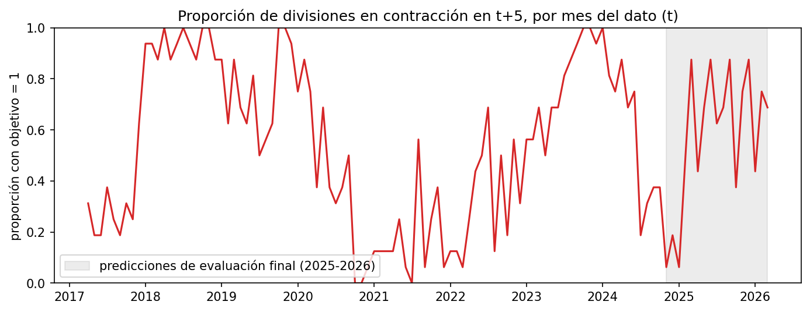
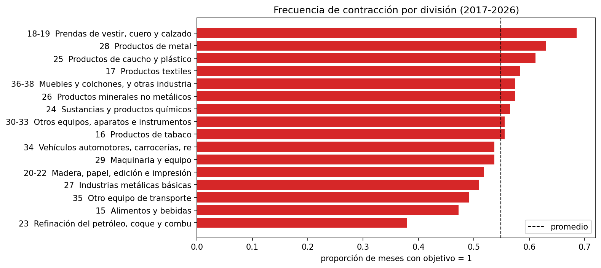
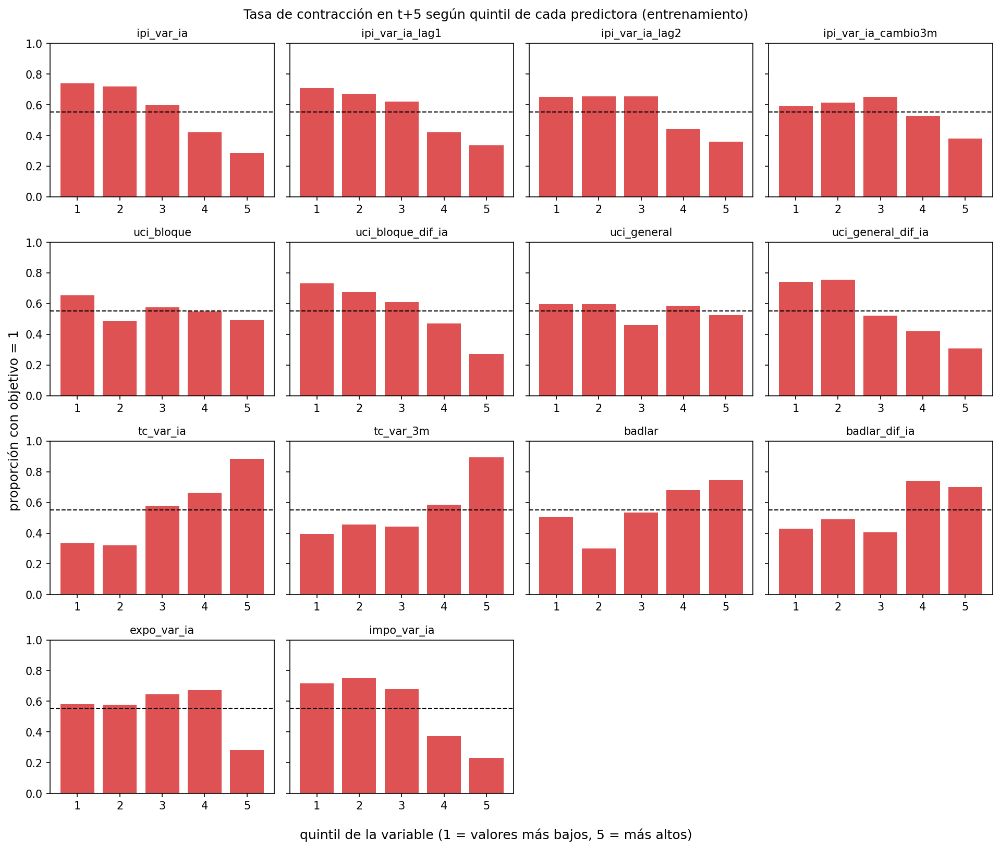
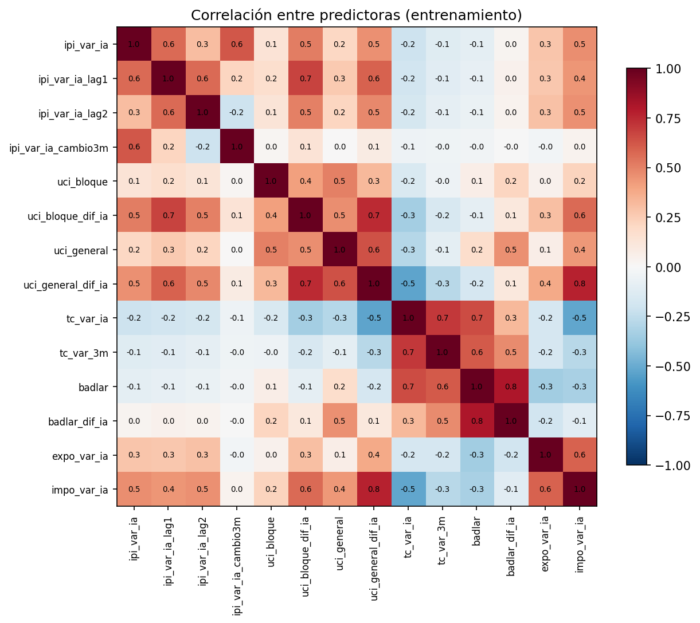

# Datos, preparación y análisis exploratorio

Este documento describe de dónde salen los datos, cómo se transforman en la tabla de modelado y qué mostró el análisis exploratorio. El código está en [`notebooks/1.0-mf-carga-exploracion-dataset.ipynb`](../notebooks/1.0-mf-carga-exploracion-dataset.ipynb) y en el módulo [`contraccion_industrial/`](../contraccion_industrial). Todas las variables se describen en el [diccionario de datos](diccionario_de_datos.md).

## 1. Origen de los datos

Todos los datos son **reales y de dominio público**, publicados por el INDEC y el Banco Central (BCRA). Se descargaron manualmente desde los sitios oficiales y se guardan sin modificar en [`data/raw/`](../data/raw).

| Archivo | Contenido | Organismo | Enlace de descarga | Fecha de descarga | Período |
|---|---|---|---|---|---|
| `sh_ipi_manufacturero_2026.xls` | Índice de producción industrial manufacturero (IPI) por división y subclase, base 2004 = 100 (hoja *Cuadro 2*) | INDEC | https://www.indec.gob.ar/ftp/cuadros/economia/sh_ipi_manufacturero_2026.xls | 07/10/2026 | ene-2016 a ago-2026 |
| `sh_capacidad_09_26.xls` | Utilización de la capacidad instalada en la industria: nivel general y 12 bloques sectoriales (%), publicación de septiembre 2026 | INDEC | https://www.indec.gob.ar/ftp/cuadros/economia/sh_capacidad_09_26.xls | 25/10/2026 | ene-2016 a jul-2026 |
| `balanmensual.xls` | Balanza comercial: exportaciones e importaciones mensuales, millones de USD | INDEC | https://www.indec.gob.ar/ftp/cuadros/economia/balanmensual.xls | 25/10/2026 | ene-1990 a sep-2026 |
| `com3500.xls` | Tipo de cambio de referencia Com. "A" 3500 (mayorista), diario y promedio mensual | BCRA | https://www.bcra.gob.ar/archivos/Pdfs/PublicacionesEstadisticas/com3500.xls | 25/10/2026 | mar-2002 a oct-2026 |
| `series.xlsm` | Series monetarias y financieras; se usa la hoja *TASAS DE MERCADO* (BADLAR de bancos privados) | BCRA | https://www.bcra.gob.ar/archivos/Pdfs/PublicacionesEstadisticas/series.xlsm | 25/10/2026 | ene-2003 a oct-2026 |

Metodología del IPI: [`references/metodologia_ipi_manufacturero_2019.pdf`](../references/metodologia_ipi_manufacturero_2019.pdf) y [`references/nota_metodologica_ipi_manufacturero_2025.pdf`](../references/nota_metodologica_ipi_manufacturero_2025.pdf). Tipo de cambio: https://www.bcra.gob.ar/tipo-cambio-referencia-comunicacion-a-3500-tcnpm/

**Calendario de publicación.** Determina qué información está disponible al predecir:
- IPI del mes *t*: se publica en el mes *t+2* (por ejemplo, agosto 2026 en el informe de octubre 2026). **Ese es el momento de la predicción.**
- Capacidad instalada del mes *t*: se publica en *t+2*. Por prudencia, se usa con un mes de rezago adicional.
- Balanza comercial del mes *t*: se publica en *t+1*.
- Tipo de cambio y tasas: publicación diaria.

## 2. Preparación de los datos

Los archivos originales son planillas pensadas para leer, no para procesar:
- encabezados repartidos en varias filas;
- el año escrito una sola vez;
- asteriscos que marcan datos provisorios, y notas al pie;
- algunos errores, como el mes "Septiembree" en la balanza o fechas escritas como texto en la hoja mensual del tipo de cambio.

Todo se resuelve con dos scripts, que se pueden volver a correr cuando se actualicen los datos. Desde la carpeta raíz del repositorio:

```bash
python -m contraccion_industrial.dataset    # IPI → data/processed/ipi_divisiones_mensual.csv
python -m contraccion_industrial.features   # une todo → data/processed/tabla_modelo.csv
```

1. **IPI:** se toman las 16 divisiones de la hoja *Cuadro 2* y se pasan a formato largo (una fila por división y mes).
2. **Variables del IPI:**
   - variación interanual de *t*, *t-1* y *t-2*;
   - cambio de la variación interanual en 3 meses;
   - indicador de contracción actual.
3. **Variable objetivo:** 1 si IPI(*t+5*) < IPI(*t-7*), es decir, si la división está en contracción interanual 3 meses después de la decisión.
4. **Capacidad instalada:** cada división toma la de su bloque sectorial (ver sección 4) y la del nivel general, con un mes de rezago. Se usan el nivel y la diferencia interanual.
5. **Tipo de cambio:** promedio mensual calculado desde la serie diaria; coincide con el promedio oficial (por ejemplo, agosto 2026: 1.499,96). Se usan la variación interanual y la de 3 meses.
6. **Tasa BADLAR** (bancos privados, TNA): promedio mensual de la serie diaria; nivel y diferencia interanual. Si el último mes está incompleto, se descarta.
7. **Balanza comercial:** variación interanual de exportaciones e importaciones.
8. **Columnas de disponibilidad temporal:** en qué mes se toma la decisión y en qué mes se conoce el resultado (sección 7).
9. **Faltantes:** se excluyen los primeros meses sin historia suficiente para los rezagos y las diferencias interanuales (enero a marzo de 2017, 48 filas), **sin imputar**. La función `excluir_sin_historia` de [`particiones.py`](../contraccion_industrial/modeling/particiones.py) verifica que después no quede ningún faltante.
10. **Escalado:** para la regresión logística y KNN, escalado dentro de un `Pipeline`, ajustado solo con el entrenamiento de cada corte temporal ([`preprocesamiento.py`](../contraccion_industrial/modeling/preprocesamiento.py)). Estándar o robusto, a elegir por validación. Los árboles no necesitan escalado.
11. **Valores extremos:** las variaciones de abril-mayo 2020 y abril 2021 (cierre por la pandemia y rebote) son reales. **Se conservan**: no se recortan ni se corrigen. Escalar no los trata; solo cambia la unidad de cada variable.

**Sobre las variaciones interanuales.** Comparar cada mes con el mismo mes del año anterior **reduce** parte del efecto estacional y pone en una escala comparable series de niveles muy distintos. Pero hay que distinguir tres cosas:
- **Crecimiento interanual** (lo que se usa): no garantiza eliminar la estacionalidad. Los cambios en días hábiles, feriados o en el patrón estacional de un sector siguen afectando la comparación.
- **Ajuste estacional** (por ejemplo, X-13 ARIMA-SEATS): procedimiento específico que estima y quita el componente estacional. No se aplicó.
- **Ajuste por precios:** deflactar una serie nominal por un índice de precios. No se aplicó: la variación del tipo de cambio sigue siendo **nominal**, igual que la BADLAR. El IPI es un índice de volumen físico y no lo necesita.

## 3. Dataset final

[`data/processed/tabla_modelo.csv`](../data/processed/tabla_modelo.csv):

- **Instancias:** 2.048 (16 divisiones × 128 meses, de enero 2016 a agosto 2026). Cada fila es **una división en un mes**.
- **Filas modelables:** 1.728 (abril 2017 a marzo 2026). Tienen la variable objetivo observada y ningún faltante en las predictoras.
- **Columnas:** 24 en total:
  - 4 de identificación;
  - 3 de control temporal;
  - 15 predictoras numéricas (14 continuas y una binaria);
  - la variable objetivo binaria;
  - el nivel del IPI, que es auxiliar.
- **Clases:** 54,9% de las filas modelables están en contracción (objetivo = 1), con mucha variación entre años.

**Predictoras** (detalle en el [diccionario de datos](diccionario_de_datos.md)):

| Grupo | Variables |
|---|---|
| Evolución de la propia división | `ipi_var_ia`, `ipi_var_ia_lag1`, `ipi_var_ia_lag2`, `ipi_var_ia_cambio3m`, `contraccion_hoy` |
| Capacidad instalada (con un mes de rezago) | `uci_bloque`, `uci_bloque_dif_ia`, `uci_general`, `uci_general_dif_ia` |
| Tipo de cambio | `tc_var_ia`, `tc_var_3m` |
| Tasa de interés | `badlar`, `badlar_dif_ia` |
| Comercio exterior | `expo_var_ia`, `impo_var_ia` |

## 4. Correspondencia entre divisiones y bloques de capacidad instalada

El INDEC publica la capacidad instalada en 12 bloques, que no coinciden uno a uno con las 16 divisiones del IPI ([`correspondencia_division_bloque.csv`](../data/external/correspondencia_division_bloque.csv)):

| División IPI | Bloque de capacidad | Criterio |
|---|---|---|
| 15 Alimentos y bebidas | Productos alimenticios y bebidas | directa |
| 16 Productos de tabaco | Productos del tabaco | directa |
| 17 Productos textiles | Productos textiles | directa |
| 18-19 Prendas de vestir, cuero y calzado | Productos textiles | aproximada (sin bloque propio) |
| 20-22 Madera, papel, edición e impresión | Promedio simple de Papel y cartón + Edición e impresión | aproximación propia |
| 23 Refinación del petróleo | Refinación del petróleo | directa |
| 24 Sustancias y productos químicos | Sustancias y productos químicos | directa (el bloque excluye farmacéutica) |
| 25 Caucho y plástico | Productos de caucho y plástico | directa |
| 26 Minerales no metálicos | Productos minerales no metálicos | directa |
| 27 Metálicas básicas | Industrias metálicas básicas | directa |
| 28 Productos de metal | Metalmecánica excl. automotriz | bloque agregado |
| 29 Maquinaria y equipo | Metalmecánica excl. automotriz | bloque agregado |
| 30-33 Otros equipos e instrumentos | Metalmecánica excl. automotriz | bloque agregado |
| 34 Vehículos automotores | Industria automotriz | directa |
| 35 Otro equipo de transporte | Metalmecánica excl. automotriz | bloque agregado |
| 36-38 Muebles y otras | Nivel general | sin bloque |

El promedio usado para 20-22 es una **aproximación propia**, no una medición oficial: no está ponderado y no incluye la madera, que no tiene bloque propio.

## 5. Análisis exploratorio

Las estadísticas de relación entre predictoras y objetivo se calculan **solo con el conjunto de entrenamiento** (1.376 filas, abril 2017 a mayo 2024), para no mirar 2025-2026 antes de la evaluación final.

### La variable objetivo cambia mucho de un año a otro

| Año del dato | 2017* | 2018 | 2019 | 2020 | 2021 | 2022 | 2023 | 2024 | 2025 | 2026* |
|---|---|---|---|---|---|---|---|---|---|---|
| Proporción en contracción en *t+5* | 0,30 | 0,94 | 0,76 | 0,42 | 0,18 | 0,32 | 0,77 | 0,53 | 0,64 | 0,62 |

\* 2017 desde abril; 2026 hasta marzo.



Las contracciones se concentran en las recesiones (2018-2019, 2023 y la segunda mitad de 2025). En los cambios de ciclo, la proporción pasa de casi todas a casi ninguna división en pocos meses. Las divisiones también difieren mucho entre sí:



### Relación de cada predictora con la contracción (entrenamiento)

La **AUC univariada** indica qué tan bien separa una sola variable los casos con y sin contracción. 0,5 es nada; los valores por debajo de 0,5 indican una relación inversa. La tasa por quintil muestra qué proporción de cada grupo de valores termina en contracción.

| Variable | AUC | Contracción en el quintil más bajo | Contracción en el quintil más alto |
|---|---|---|---|
| `tc_var_ia` | 0,74 | 33% | 88% |
| `impo_var_ia` | 0,29 | 72% | 23% |
| `uci_general_dif_ia` | 0,29 | 74% | 31% |
| `ipi_var_ia` | 0,30 | 74% | 28% |
| `uci_bloque_dif_ia` | 0,31 | 73% | 27% |
| `tc_var_3m` | 0,67 | 40% | 89% |
| `contraccion_hoy` | 0,65 | — | — |
| `badlar_dif_ia` | 0,65 | 43% | 70% |
| `badlar` | 0,65 | 50% | 75% |
| `uci_bloque`, `uci_general` (niveles) | 0,46 | — | — |



Estar en contracción hoy eleva la proporción de contracción en *t+5* **del 39% al 70%**. Los pares de predictoras más correlacionados son:
- la BADLAR con su diferencia interanual (0,81);
- la capacidad general con las importaciones (0,77);
- la capacidad del bloque con la general (0,75).



## 6. Conclusiones del análisis exploratorio

- **La inercia es fuerte, pero no alcanza.** Estar en contracción hoy eleva mucho la probabilidad de estarlo 3 meses después de la decisión, pero falla justamente en los cambios de ciclo, que son los que interesa anticipar.
- **Las variables externas muestran asociación con la contracción futura:**
  - una devaluación fuerte (`tc_var_ia`);
  - la caída de las importaciones y de la capacidad instalada respecto del año anterior;
  - una BADLAR alta o en suba.

  En el entrenamiento, varias de ellas separan mejor que la propia evolución reciente de la división.
- **Precaución:** las variables macro tienen **un solo valor por mes**, igual para las 16 divisiones, y su relación se apoya en pocos episodios: las recesiones de 2018-2019 y 2023. Además, el tipo de cambio y la BADLAR son **nominales**. Estas asociaciones son **hipótesis** que la validación temporal tiene que poner a prueba, no relaciones causales.
- La capacidad instalada informa a través de su **cambio interanual**, no de su nivel.
- Las predictoras tienen escalas muy distintas, desde proporciones hasta puntos porcentuales y % TNA. Por eso los modelos sensibles a escala (logística, KNN) necesitan escalado.

## 7. Disponibilidad temporal y separación de los datos

Implementado en [`particiones.py`](../contraccion_industrial/modeling/particiones.py):

- **Momento de la predicción y horizonte.** Una fila de diciembre 2024 se predice en febrero 2025, cuando se publica su IPI. El objetivo es mayo 2025, 3 meses después de la decisión, y el resultado se conoce en julio 2025. El entrenamiento solo incluye filas cuyo resultado se conocía antes del corte.
- **Los meses no se reparten entre conjuntos.** Todas las separaciones filtran por fecha, nunca por posición de fila, y una verificación automática lo comprueba.
- **Predicciones sin resultado** (filas de abril a agosto 2026): quedan como pendientes. Son los casos nuevos reales con los que se muestra el uso del modelo.

| Conjunto | Filas | Datos de |
|---|---|---|
| Entrenamiento (corte enero 2025) | 1.376 | 04/2017 a 05/2024 |
| Evaluación final (predicciones 2025-2026) | 272 | 11/2024 a 03/2026 |
| Pendientes | 80 | 04/2026 a 08/2026 |

Las filas de junio a octubre de 2024 no entran en ninguno de los dos conjuntos: sus predicciones se hicieron en 2024, pero los resultados se conocieron recién en 2025. Los hiperparámetros se eligen con **validación temporal dentro del entrenamiento**, con cortes en enero de 2021, 2022, 2023 y 2024 (ver [`02_modelo_y_resultados.md`](02_modelo_y_resultados.md)).
