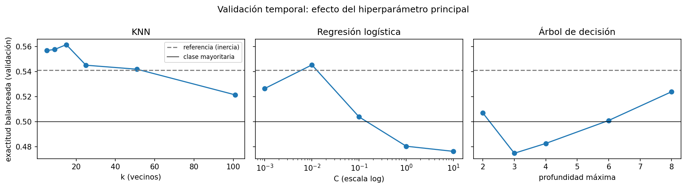
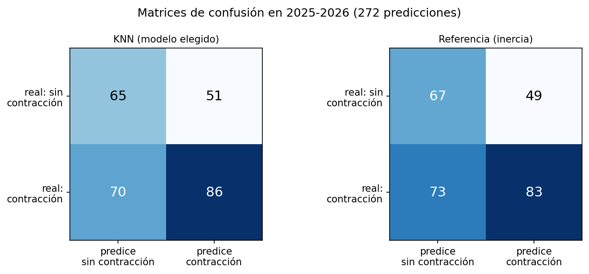
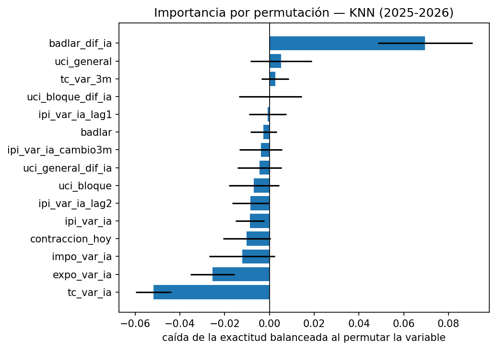
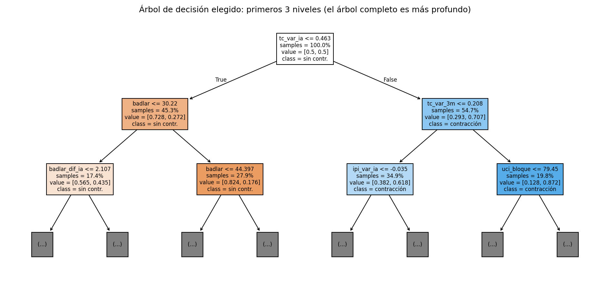

# Modelo, evaluación y resultados

El código está en [`notebooks/2.0-mf-modelado-evaluacion.ipynb`](../notebooks/2.0-mf-modelado-evaluacion.ipynb) y en [`contraccion_industrial/modeling/`](../contraccion_industrial/modeling). Todos los números de este documento salen de esa ejecución.

## 1. Qué se predice, cuándo y para qué

| Pregunta | Respuesta |
|---|---|
| Unidad de análisis | Una división de la industria manufacturera (16) en un mes *t* |
| Variable objetivo | 1 = la división está en **contracción interanual** en el mes *t+5* (producción menor que en el mismo mes del año anterior); 0 = no lo está. **Clase positiva: contracción.** |
| Momento de la predicción | Mes *t+2*, cuando el INDEC publica el IPI del mes *t* |
| Horizonte | 3 meses desde la decisión; el resultado se conoce en *t+7* |
| Información de entrada | 15 predictoras publicadas antes de *t+2* (ver [diccionario](diccionario_de_datos.md)) |
| Uso previsto | Alerta temprana: priorizar el seguimiento de las divisiones con más riesgo de caída. **Falso negativo:** una contracción que no se anticipó. **Falso positivo:** una alerta que no se cumplió. |

## 2. Arquitectura del experimento

```
data/raw  ──►  dataset.py / features.py  ──►  tabla_modelo.csv (2.048 filas)
                                                   │
                         excluir_sin_historia (−48 filas, sin imputar)
                                                   │
          ┌────────────────────────────┬───────────┴────────────────┬───────────────────────┐
   Entrenamiento (1.376)        [hueco: 06-10/2024]      Evaluación final (272)      Pendientes (80)
   datos 04/2017–05/2024                                 datos 11/2024–03/2026       datos 04–08/2026
          │                                                     │                          │
   Validación temporal (4 cortes: 2021, 2022, 2023, 2024)       │                          │
   grillas de hiperparámetros ─► configuración elegida ─► entrenar 1 vez ─► evaluar 1 vez  │
                                                                │                          │
                                     reentrenar con entrenamiento + evaluación ─► predecir casos nuevos
```

**Pipeline de cada modelo.** Logística y KNN usan escalado + modelo; árbol, Random Forest y Gradient Boosting usan solo el modelo. El escalado aprende la media y el desvío (o la mediana y el rango intercuartílico) **únicamente con el entrenamiento de cada corte**, y después los aplica sin cambios a la validación, la evaluación y los casos nuevos.

## 3. Algoritmos y cómo predicen

| Modelo | Cómo produce una predicción |
|---|---|
| **Referencia (inercia)** | Predice que la división va a estar igual que en el último dato publicado (`contraccion_hoy`). |
| **Clase mayoritaria** | Predice siempre "contracción", la clase más frecuente del entrenamiento (`DummyClassifier`). |
| **Regresión logística** | Combina las variables escaladas con pesos aprendidos (más un intercepto), transforma esa suma en una probabilidad con la función sigmoide y asigna "contracción" si la probabilidad es ≥ 0,5. |
| **KNN** | Busca los *k* casos del entrenamiento más parecidos (distancia euclídea sobre las variables escaladas) y estima la probabilidad como la proporción de esos vecinos que terminaron en contracción. |
| **Árbol de decisión** | Recorre preguntas del tipo "¿variable ≤ umbral?" hasta llegar a una hoja, y predice la clase de esa hoja. |
| **Random Forest** | Promedia las probabilidades de 300 árboles, cada uno entrenado con una muestra distinta de filas y de variables. |
| **Gradient Boosting** | Suma árboles chicos en secuencia: cada uno corrige parte del error de los anteriores. |

## 4. Elección de hiperparámetros (solo con validación)

**Criterio: exactitud balanceada** (promedio del recall de cada clase). La proporción de contracciones en los cortes de validación va del **15% al 87%**. Con esas proporciones, el F1 de la clase "contracción" premia a quien dice siempre "contracción": en validación, la clase mayoritaria obtiene un F1 de 0,61 sin anticipar nada. La exactitud balanceada vale 0,5 para cualquier clasificador que diga siempre lo mismo.

Se validaron **110 configuraciones** (grillas en [`train.py`](../contraccion_industrial/modeling/train.py)). La mejor de cada algoritmo:

| Modelo | Configuración elegida | Exactitud balanceada (promedio 4 cortes) | Desvío entre cortes |
|---|---|---|---|
| **KNN** | k = 15, voto uniforme, escalado estándar | **0,562** | 0,055 |
| Regresión logística | C = 0,01, `class_weight` balanceado, escalado robusto | 0,545 | 0,055 |
| Random Forest | profundidad 3, mín. 5 por hoja, 50% de variables, balanceado | 0,527 | 0,053 |
| Árbol de decisión | profundidad 8, mín. 10 por hoja, balanceado | 0,524 | 0,025 |
| Gradient Boosting | learning rate 0,1, profundidad 3, 300 árboles | 0,522 | 0,048 |
| Referencia (inercia) | — | 0,541 | — |
| Clase mayoritaria | — | 0,500 | — |



**Modelo elegido: KNN con k = 15.** Su ventaja sobre la referencia en validación (0,02) es menor que la variación entre cortes, lo que ya sugería que la mejora podría no ser clara. En KNN, los k chicos (5 a 15) dan resultados parecidos; con k = 51 o 101 empeora, porque la votación se parece cada vez más a la proporción general. La regresión logística necesita regularización fuerte (C = 0,01).

## 5. Evaluación final en 2025-2026

Cada modelo se entrenó **una vez** con todo el entrenamiento y se evaluó **una vez** en las mismas 272 predicciones. Ningún resultado de esta tabla se usó para elegir ni ajustar nada. El 57,4% de los casos fueron contracción.

| Modelo | Exactitud | Exactitud balanceada | Precisión | Recall | F1 | AUC |
|---|---|---|---|---|---|---|
| **KNN (elegido)** | 0,555 | **0,556** | 0,628 | 0,551 | 0,587 | 0,572 |
| Regresión logística | 0,548 | 0,602 | 0,923 | 0,231 | 0,369 | 0,664 |
| Random Forest | 0,382 | 0,445 | 0,167 | 0,019 | 0,034 | 0,486 |
| Árbol de decisión | 0,404 | 0,469 | 0,312 | 0,032 | 0,058 | 0,536 |
| Gradient Boosting | 0,555 | 0,569 | 0,655 | 0,474 | 0,550 | 0,604 |
| Referencia (inercia) | 0,551 | 0,555 | 0,629 | 0,532 | 0,576 | — |
| Clase mayoritaria | 0,574 | 0,500 | 0,574 | 1,000 | 0,729 | — |

Precisión, recall y F1 corresponden a la clase "contracción", con umbral 0,5.



**Modelo elegido (KNN):**
- De las **156** contracciones reales, detectó **86** (recall 55,1%) y dejó **70** sin anticipar.
- Emitió **137** alertas: 86 correctas y **51** falsas (precisión 62,8%).
- De las 116 divisiones-mes sin contracción, reconoció 65 (recall de esa clase 56,0%).

**Referencia:** detectó 83 contracciones con 49 falsas alarmas. **En esta evaluación, el modelo elegido y la referencia tuvieron prácticamente el mismo desempeño.**

**Otras observaciones:**
- La **clase mayoritaria** tiene el F1 más alto (0,729), pero no anticipa nada: exactitud balanceada 0,500.
- La **regresión logística** obtuvo en este período la mejor exactitud balanceada (0,602) y el mejor AUC (0,664), con muy pocas alertas pero casi todas correctas (36 de 39). **No se reemplaza el modelo elegido por este resultado**, porque sería elegir con el conjunto de prueba. Queda como hipótesis para validar con más datos.
- **Random Forest y el árbol** casi no predijeron contracciones en 2025-2026 (recall 0,02 y 0,03).

**Dónde se equivoca.** En esta muestra, ni el modelo ni la referencia anticiparon el cambio de ciclo de mediados de 2025:

| Trimestre del mes predicho | 2025 T2 | 2025 T3 | 2025 T4 | 2026 T1 | 2026 T2 | 2026 T3 |
|---|---|---|---|---|---|---|
| Proporción real de contracción | 0,10 | 0,60 | 0,73 | 0,65 | 0,69 | 0,72 |
| Acierto del modelo | 0,60 | 0,40 | 0,38 | 0,58 | 0,71 | 0,72 |
| Acierto de la referencia | 0,56 | 0,50 | 0,35 | 0,60 | 0,67 | 0,66 |

## 6. Interpretación

**Importancia por permutación** (KNN, 2025-2026). Es una descripción del modelo ya elegido, no una selección. Mide cuánto cae la exactitud balanceada al mezclar al azar cada variable:
- La que más pesa es **`badlar_dif_ia`** (0,070).
- La **variación interanual del tipo de cambio** tiene importancia **negativa** (−0,052): en este período, mezclarla al azar *mejora* el modelo.

Como las variables macro son iguales para las 16 divisiones de un mes, es probable que dominen la distancia en KNN: el modelo parecería buscar sobre todo **meses parecidos** del pasado.



**Dirección de las variables** (coeficientes de la regresión logística, variables escaladas). Indican con qué valores el modelo predice **mayor** probabilidad de contracción. Son asociaciones, no causas:
- Los coeficientes más grandes, en valor absoluto, son:
  - suba de la BADLAR respecto del año anterior (+0,29);
  - caída de las importaciones (−0,25);
  - caída de la producción de la propia división (−0,20);
  - devaluación en 3 meses y en 12 meses (+0,19 y +0,16);
  - caída de la capacidad instalada (−0,16).
- Estar en contracción hoy suma +0,14.

**Un caso concreto: Maquinaria y equipo, dato de diciembre de 2024** (predicción hecha en febrero de 2025 para mayo de 2025; resultado real: sin contracción):
- **KNN:** 4 de sus 15 vecinos terminaron en contracción. La probabilidad es 0,27 < 0,5, así que predice **sin contracción** (acierta). La mayoría de los vecinos son de septiembre de 2020, porque la caída fuerte de la BADLAR se parece a la salida de la pandemia.
- **Regresión logística:** z = −1,67, probabilidad 0,16. Predice sin contracción con umbral 0,5, y también con un umbral más bajo como 0,35.
- **Árbol:** hace cuatro preguntas hasta llegar a una hoja con solo un 14% (ponderado) de contracciones, y predice sin contracción:
  1. ¿variación interanual del tipo de cambio ≤ 0,463? → no (0,59);
  2. ¿variación del tipo de cambio en 3 meses ≤ 0,208? → sí (0,061);
  3. ¿variación interanual del IPI ≤ −0,035? → no (+0,34);
  4. ¿variación interanual de las exportaciones ≤ 0,167? → no (0,33).



## 7. Uso del modelo con casos nuevos

Para predecir hacia adelante, KNN (k = 15) se reentrenó con las 1.648 filas cuyo resultado ya se conoce (entrenamiento + evaluación). Se guardó en [`models/modelo_final.joblib`](../models/modelo_final.joblib) junto con su escalado.

```bash
python -m contraccion_industrial.modeling.predict   # predice las filas pendientes
```

```python
from contraccion_industrial.modeling.predict import cargar_modelo, predecir
modelo = cargar_modelo()
resultado = predecir(modelo, nuevas_filas)   # DataFrame con las 15 predictoras
```

**Predicciones reales pendientes** ([`models/predicciones_pendientes.csv`](../models/predicciones_pendientes.csv)). Con el último dato publicado (agosto 2026, predicción de octubre 2026), el modelo predice contracción en **enero de 2027** para **12 de las 16 divisiones**. Las de mayor probabilidad son:

| División | Probabilidad |
|---|---|
| Otros equipos, aparatos e instrumentos | 0,93 |
| Maquinaria y equipo | 0,80 |
| Tabaco; Caucho y plástico; Productos de metal; Automotores | 0,73 cada una |

Predice sin contracción para químicos, madera-papel-edición, refinación y metálicas básicas. Estas predicciones se podrán verificar cuando el INDEC publique el IPI de esos meses.

El notebook también muestra un **caso sintético** cargado a mano, para mostrar el formato de entrada: una división que hoy cae 8% con devaluación fuerte. Para ese caso el modelo da una probabilidad de 0,80 de contracción. Ese caso no sirve para evaluar el modelo.

## 8. Conclusiones

Se apoyan en la evidencia de este trabajo y se presentan como resultados acotados e hipótesis.

- **Sobre el objetivo planteado.** Con las variables disponibles y 3 meses de horizonte desde la decisión, el modelo elegido detectó el **55%** de las contracciones de 2025-2026, con un **63%** de alertas correctas: un desempeño **prácticamente igual al de la referencia de inercia**. Con esta evidencia **no es posible afirmar** que el modelo anticipe mejor que suponer que cada división seguirá como en el último dato.
- **Dónde parecería estar la dificultad.** En esta muestra, ningún modelo anticipó los cambios de ciclo (2021 y mediados de 2025). En los trimestres más estables, tanto el modelo como la referencia acertaron alrededor del 70%.
- **Qué aporta el trabajo:**
  - un procedimiento de evaluación sin fuga de información, que respeta el calendario de publicación;
  - la comparación con referencias, que mostró que un F1 alto podía ser engañoso;
  - un modelo listo para usar, con estimaciones que podrán contrastarse con datos reales.
- **Hipótesis (no comprobadas):**
  - es posible que las variables nominales (tipo de cambio, BADLAR) cambien de significado cuando cambia la inflación; eso podría explicar la caída de los árboles en 2025-2026 y la importancia negativa del tipo de cambio;
  - una regresión logística conservadora podría ser preferible si se priorizan alertas muy precisas.

## 9. Limitaciones y trabajo futuro

**Limitaciones:**
- Pocos ciclos económicos (2017-2026).
- Las variables macro tienen un solo valor por mes para las 16 divisiones.
- Se usan series revisadas, no las versiones que estaban publicadas en cada momento.
- No hay ajuste por precios ni ajuste estacional.
- La capacidad instalada se asigna por aproximación en tres divisiones.
- El umbral está fijo en 0,5.
- Hay solo 17 predicciones por división en la evaluación final.
- No se pudieron conseguir las importaciones separadas por uso económico.

**Trabajo futuro:**
- Deflactar las variables nominales.
- Usar series desestacionalizadas.
- Incorporar la división como variable categórica.
- Elegir el umbral con validación según el costo de cada error.
- Reentrenar el modelo a medida que el INDEC publique nuevos meses, y verificar las predicciones pendientes.
