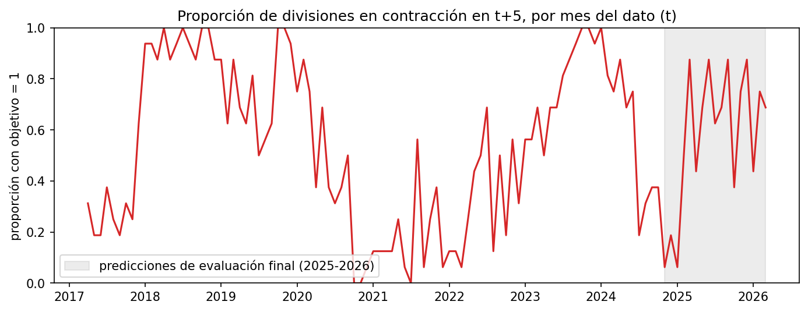
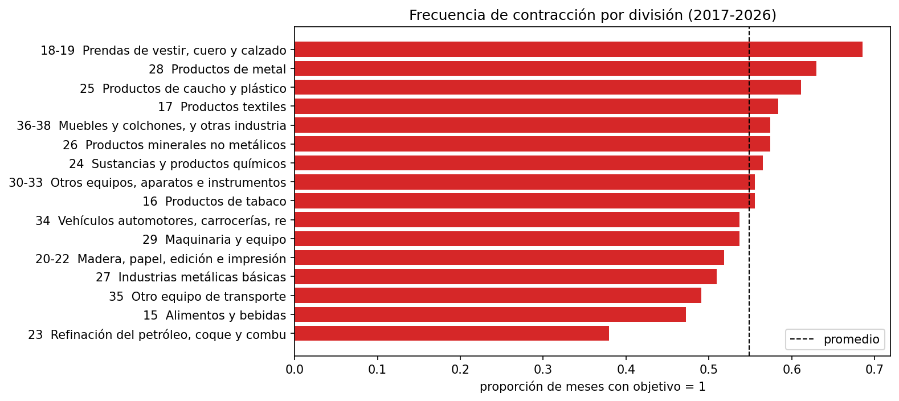
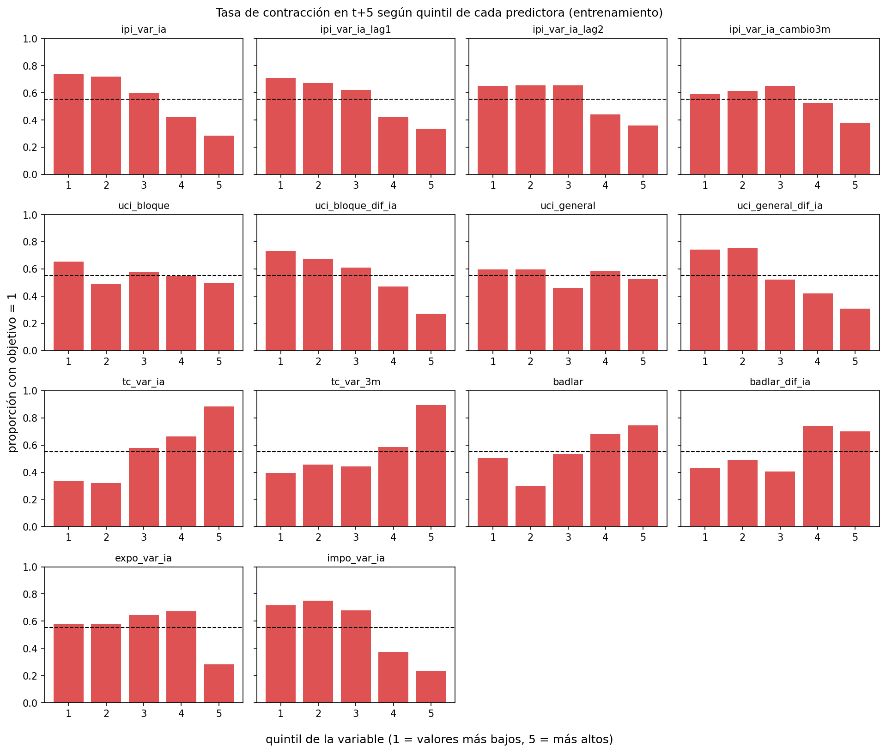
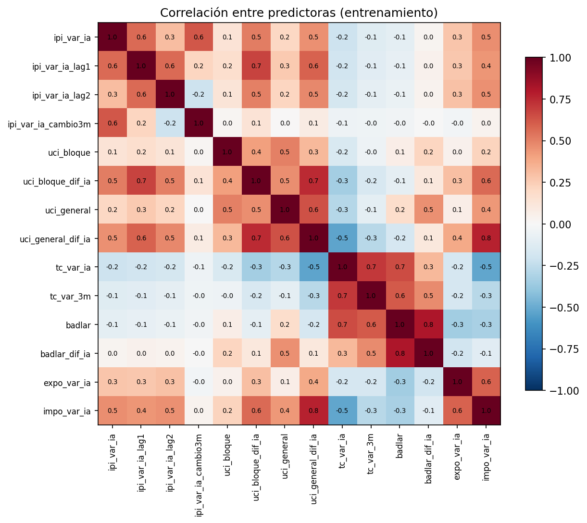
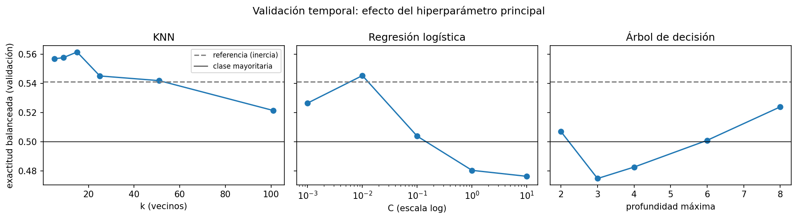
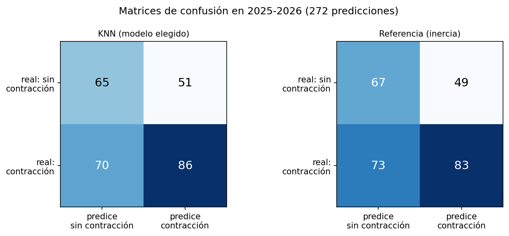
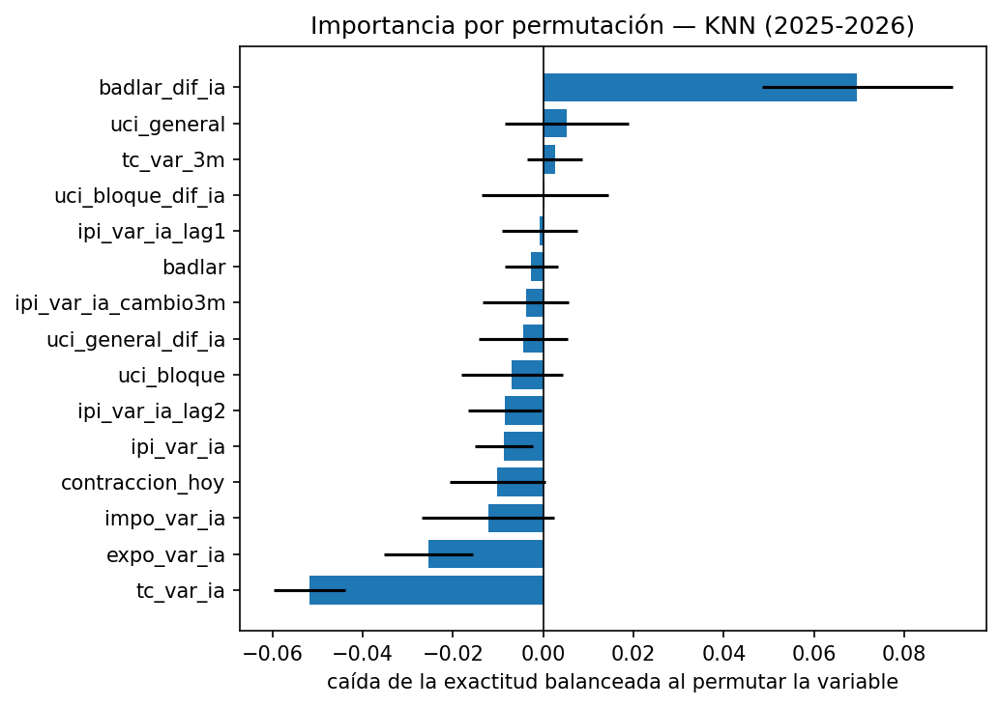
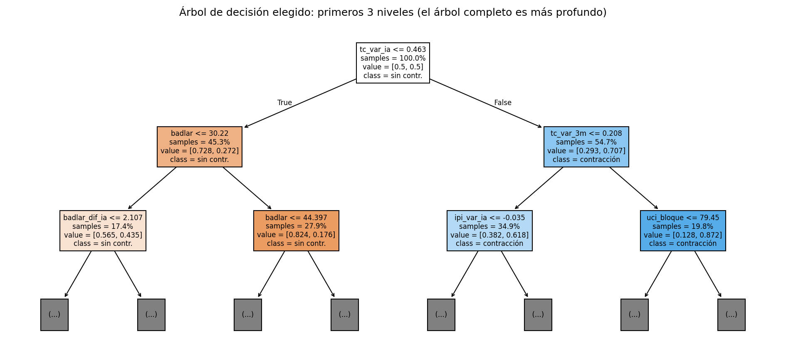

# Presentación final y análisis de resultados

**Predicción de contracción interanual en la industria manufacturera argentina: un modelo de clasificación bajo disponibilidad real de información**

**Proyecto de Aprendizaje Automático** · Tecnicatura Superior en Ciencia de Datos e Inteligencia Artificial
**Alumna:** Mónica Frías · **Docente:** Nicolás Caballero · Entrega 3 · Noviembre 2026

🎥 **Video de presentación:** https://youtu.be/uye00F1roiw

Este informe reúne en un solo documento el recorrido completo del proyecto. El detalle técnico ampliado está en [`docs/01_datos_y_exploracion.md`](../docs/01_datos_y_exploracion.md), [`docs/02_modelo_y_resultados.md`](../docs/02_modelo_y_resultados.md) y el [diccionario de datos](../docs/diccionario_de_datos.md). Todo el código está en los notebooks [`1.0`](../notebooks/1.0-mf-carga-exploracion-dataset.ipynb) y [`2.0`](../notebooks/2.0-mf-modelado-evaluacion.ipynb).

---

## 1. Introducción y fundamentación

La industria manufacturera es uno de los sectores que más empleo formal genera en Argentina y uno de los más sensibles a los cambios de la economía. La demanda interna, el tipo de cambio, el costo del financiamiento y la competencia de los productos importados afectan de forma distinta a cada rama: un mismo contexto puede favorecer a unas y perjudicar a otras.

En 2026 la situación fue muy cambiante. Según el INDEC, el índice de producción industrial manufacturero (IPI) cayó 5,7% en mayo y subió 2,0% en junio. En agosto de 2026, 11 de las 16 divisiones produjeron menos que un año antes, con caídas de hasta 24% (Maquinaria y equipo), mientras que Otro equipo de transporte creció 12%.

Anticipar qué ramas podrían estar en contracción en los próximos meses sería útil para empresas, cámaras sectoriales y organismos públicos que necesitan planificar con tiempo producción, compras, empleo, financiamiento o políticas de apoyo sectorial.

La particularidad del proyecto es que respeta el **calendario real de publicación** de los datos: cada predicción usa solo información que ya estaba publicada en el momento en que se habría tomado la decisión.

## 2. Objetivos

**Objetivo general.** Desarrollar un modelo de aprendizaje automático que anticipe, con 3 meses de horizonte desde el momento de la predicción, si cada una de las 16 divisiones de la industria manufacturera argentina va a presentar una caída interanual de su producción, a partir de factores económicos que influyen sobre la industria y de la evolución reciente de cada rama.

**Objetivos específicos:**
1. Integrar en una única base mensual, por división, la producción industrial y las variables explicativas, usando para cada mes solo información ya publicada.
2. Explorar la relación de las predictoras con la variable objetivo, con decisiones tomadas solo dentro del período de entrenamiento.
3. Describir la evolución de cada división e identificar períodos de expansión y contracción.
4. Entrenar distintos modelos de clasificación, elegir sus hiperparámetros con validación temporal y compararlos con referencias simples.
5. Evaluar el modelo en 2025-2026, interpretar qué variables pesan más y mostrar cómo se usa con casos nuevos.

## 3. Planteo del problema

| Definición | En este proyecto |
|---|---|
| **Tipo de problema** | Clasificación binaria supervisada |
| **Unidad de análisis** | Una división de la industria manufacturera (16, CLaNAE 2004) en un mes *t* |
| **Momento de la predicción** | Mes *t+2*, cuando el INDEC publica el IPI del mes *t* |
| **Horizonte** | 3 meses desde la decisión: se predice el mes *t+5*; el resultado se conoce en *t+7* |
| **Variable objetivo** | 1 si IPI(*t+5*) < IPI(*t-7*) (contracción interanual), 0 si no. **Clase positiva: contracción** |
| **Uso previsto** | Alerta temprana. Falso negativo: contracción no anticipada. Falso positivo: alerta que no se cumplió |

**Ejemplo:** con el dato de diciembre de 2024, publicado en febrero de 2025, se predice si mayo de 2025 estará por debajo de mayo de 2024. El resultado se conoce en julio de 2025.

La regla IPI(*t+5*) < IPI(*t-7*) solo **define la etiqueta**: en el momento de la predicción ese dato todavía no existe. El modelo aprende de los casos históricos la relación entre las condiciones de un mes y lo que le pasó a la rama 3 meses después de la decisión.

## 4. Origen y construcción del dataset

### 4.1 Fuentes

Todos los datos son **reales y públicos**, de frecuencia mensual, y se guardan sin modificar en [`data/raw/`](../data/raw). Los enlaces y fechas de descarga están en [`docs/01_datos_y_exploracion.md`](../docs/01_datos_y_exploracion.md#1-origen-de-los-datos).

| Fuente | Datos | Variables que se construyen |
|---|---|---|
| INDEC | IPI manufacturero por división (base 2004 = 100), ene-2016 a ago-2026 | Objetivo; variación interanual actual y de los dos meses previos; aceleración; contracción actual |
| INDEC | Utilización de la capacidad instalada (nivel general y 12 bloques) | Nivel y diferencia interanual, del bloque y del nivel general (con un mes de rezago) |
| BCRA | Tipo de cambio mayorista (Com. A 3500) | Variación interanual y de 3 meses |
| BCRA | Tasa BADLAR de bancos privados | Nivel y diferencia interanual |
| INDEC | Balanza comercial | Variación interanual de exportaciones e importaciones |

**Calendario de publicación**, que define qué información está disponible al predecir:
- IPI del mes *t*: se publica en *t+2* (momento de la predicción).
- Capacidad instalada de *t*: se publica en *t+2*; por prudencia se usa con un mes de rezago adicional.
- Balanza comercial de *t*: se publica en *t+1*.
- Tipo de cambio y tasas: publicación diaria.

### 4.2 Dataset final

[`data/processed/tabla_modelo.csv`](../data/processed/tabla_modelo.csv):
- **2.048 instancias** (16 divisiones × 128 meses, enero 2016 a agosto 2026) y **24 columnas**: 4 de identificación, 3 de control temporal, **15 predictoras** numéricas (14 continuas y una binaria), la variable objetivo binaria y el nivel del IPI (auxiliar).
- **1.728 filas modelables** (abril 2017 a marzo 2026), con objetivo observado y sin faltantes.
- **54,9%** de esas filas están en contracción.

| Grupo | Predictoras |
|---|---|
| Evolución de la propia división | `ipi_var_ia`, `ipi_var_ia_lag1`, `ipi_var_ia_lag2`, `ipi_var_ia_cambio3m`, `contraccion_hoy` |
| Capacidad instalada (un mes de rezago) | `uci_bloque`, `uci_bloque_dif_ia`, `uci_general`, `uci_general_dif_ia` |
| Tipo de cambio | `tc_var_ia`, `tc_var_3m` |
| Tasa de interés | `badlar`, `badlar_dif_ia` |
| Comercio exterior | `expo_var_ia`, `impo_var_ia` |

El significado, tipo, unidad y fuente de cada variable, incluidas las de los archivos originales que no se usan, están en el [**diccionario de datos**](../docs/diccionario_de_datos.md). La correspondencia entre las 16 divisiones y los 12 bloques de capacidad instalada se detalla en [`docs/01`, sección 4](../docs/01_datos_y_exploracion.md#4-correspondencia-entre-divisiones-y-bloques-de-capacidad-instalada).

## 5. Análisis exploratorio

Las relaciones entre predictoras y objetivo se calcularon **solo con el conjunto de entrenamiento** (1.376 filas, abril 2017 a mayo 2024), para no mirar 2025-2026 antes de la evaluación final.

### 5.1 La proporción de contracciones cambia mucho entre años

| Año del dato | 2017* | 2018 | 2019 | 2020 | 2021 | 2022 | 2023 | 2024 | 2025 | 2026* |
|---|---|---|---|---|---|---|---|---|---|---|
| Proporción en contracción en *t+5* | 0,30 | 0,94 | 0,76 | 0,42 | 0,18 | 0,32 | 0,77 | 0,53 | 0,64 | 0,62 |

\* 2017 desde abril; 2026 hasta marzo.



Las contracciones se concentran en las recesiones (2018-2019, 2023 y la segunda mitad de 2025). En los cambios de ciclo, la proporción pasa de casi todas a casi ninguna división en pocos meses. Las divisiones también difieren mucho entre sí:



### 5.2 Relación de cada predictora con la contracción

La **AUC univariada** indica qué tan bien separa una sola variable los casos con y sin contracción (0,5 = nada; por debajo de 0,5, relación inversa).

| Variable | AUC | Contracción en el quintil más bajo | Contracción en el quintil más alto |
|---|---|---|---|
| `tc_var_ia` | 0,74 | 33% | 88% |
| `tc_var_3m` | 0,67 | 40% | 89% |
| `badlar_dif_ia` | 0,65 | 43% | 70% |
| `badlar` | 0,65 | 50% | 75% |
| `contraccion_hoy` | 0,65 | — | — |
| `ipi_var_ia` | 0,30 | 74% | 28% |
| `uci_bloque_dif_ia` | 0,31 | 73% | 27% |
| `uci_general_dif_ia` | 0,29 | 74% | 31% |
| `impo_var_ia` | 0,29 | 72% | 23% |



Estar en contracción hoy eleva la proporción de contracción en *t+5* del **39% al 70%**. Los pares de predictoras más correlacionados son la BADLAR con su diferencia interanual (0,81), la capacidad general con las importaciones (0,77) y la capacidad del bloque con la general (0,75).



### 5.3 Conclusiones del análisis exploratorio

Son observaciones sobre 2017-2024, planteadas como hipótesis para la validación:
- La **inercia** parece fuerte, aunque podría fallar justamente en los cambios de ciclo.
- Una devaluación fuerte, la caída de importaciones y de capacidad instalada, y una BADLAR alta o en suba **parecerían asociarse** con contracción futura.
- Las variables macro tienen **un solo valor por mes**, igual para las 16 divisiones, y su relación se apoya en pocos episodios. El tipo de cambio y la BADLAR son **nominales**. Estas asociaciones no implican causalidad.
- Las escalas son muy distintas, por lo que la logística y KNN necesitan escalado.

## 6. Preparación de los datos

1. **Lectura y limpieza** de planillas pensadas para leer, no para procesar (encabezados en varias filas, notas al pie, asteriscos de datos provisorios, errores de tipeo). Se resuelve con [`dataset.py`](../contraccion_industrial/dataset.py) y [`features.py`](../contraccion_industrial/features.py).
2. **Formato largo:** una fila por división y mes.
3. **Construcción de variables** (sección 4) y de la variable objetivo.
4. **Faltantes:** se excluyen enero a marzo de 2017 (48 filas), que no tienen historia suficiente para los rezagos. **No se imputa** ningún valor.
5. **Valores extremos:** las variaciones de 2020-2021 (pandemia y rebote) son reales y **se conservan**.
6. **Escalado** (estándar o robusto, elegido por validación) solo para logística y KNN, dentro de un `Pipeline` ajustado únicamente con el entrenamiento de cada corte. El escalado cambia la unidad de las variables; no trata los atípicos.
7. **Separación temporal sin fuga de información:**

| Conjunto | Filas | Datos de |
|---|---|---|
| Entrenamiento (resultado conocido antes de enero 2025) | 1.376 | 04/2017 a 05/2024 |
| Evaluación final (predicciones 2025-2026) | 272 | 11/2024 a 03/2026 |
| Pendientes (resultado aún no publicado) | 80 | 04/2026 a 08/2026 |

Los meses nunca se reparten entre conjuntos: todas las separaciones filtran por fecha.

## 7. Modelo

### 7.1 Arquitectura del experimento

```
data/raw ──► dataset.py / features.py ──► tabla_modelo.csv (2.048 filas)
                                               │
                     excluir_sin_historia (−48 filas, sin imputar)
                                               │
      ┌────────────────────────┬───────────────┴──────────────┬─────────────────────┐
 Entrenamiento (1.376)   [hueco 06-10/2024]          Evaluación final (272)   Pendientes (80)
      │                                                       │                      │
 Validación temporal (cortes 2021, 2022, 2023, 2024)          │                      │
 110 configuraciones ─► mejor por modelo ─► entrenar 1 vez ─► evaluar 1 vez          │
                                                              │                      │
                          reentrenar con entrenamiento + evaluación ─► predecir casos nuevos
```

### 7.2 Algoritmos comparados

| Modelo | Cómo predice |
|---|---|
| Referencia (inercia) | La división seguirá como en el último dato publicado |
| Clase mayoritaria | Siempre "contracción" |
| Regresión logística | Combina las variables escaladas con pesos y las transforma en probabilidad con la sigmoide; umbral 0,5 |
| KNN | Proporción de contracciones entre los *k* casos más parecidos del entrenamiento (distancia euclídea) |
| Árbol de decisión | Preguntas "¿variable ≤ umbral?" hasta una hoja |
| Random Forest | Promedio de 300 árboles entrenados con muestras distintas |
| Gradient Boosting | Árboles chicos en secuencia, cada uno corrige el error de los anteriores |

### 7.3 Elección de hiperparámetros

**Validación temporal:** en cada uno de los 4 cortes se entrena con el pasado y se valida con el año siguiente.

**Criterio: exactitud balanceada** (promedio del recall de cada clase). En los cortes de validación la proporción de contracciones va del 15% al 87%; con esa variación, el F1 premia a quien dice siempre "contracción" (0,61 en validación sin anticipar nada), mientras que la exactitud balanceada vale 0,5 para cualquier clasificador constante.

| Modelo | Configuración elegida | Exactitud balanceada (promedio 4 cortes) |
|---|---|---|
| **KNN** | **k = 15, voto uniforme, escalado estándar** | **0,562** |
| Regresión logística | C = 0,01, clases balanceadas, escalado robusto | 0,545 |
| Random Forest | profundidad 3, mín. 5 por hoja, 50% de variables | 0,527 |
| Árbol de decisión | profundidad 8, mín. 10 por hoja | 0,524 |
| Gradient Boosting | learning rate 0,1, profundidad 3, 300 árboles | 0,522 |
| Referencia (inercia) | — | 0,541 |
| Clase mayoritaria | — | 0,500 |



**Modelo elegido: KNN con k = 15.** Su ventaja sobre la referencia (0,02) ya era menor que la variación entre cortes (desvío 0,055), lo que sugería que la mejora podría no ser clara.

## 8. Resultados y evaluación

Cada modelo se entrenó **una vez** y se evaluó **una vez** en las mismas 272 predicciones de 2025-2026 (57,4% de contracciones). Nada de esta tabla se usó para elegir ni ajustar.

| Modelo | Exactitud | Exactitud balanceada | Precisión | Recall | F1 | AUC |
|---|---|---|---|---|---|---|
| **KNN (elegido)** | 0,555 | **0,556** | 0,628 | 0,551 | 0,587 | 0,572 |
| Regresión logística | 0,548 | 0,602 | 0,923 | 0,231 | 0,369 | 0,664 |
| Gradient Boosting | 0,555 | 0,569 | 0,655 | 0,474 | 0,550 | 0,604 |
| Árbol de decisión | 0,404 | 0,469 | 0,312 | 0,032 | 0,058 | 0,536 |
| Random Forest | 0,382 | 0,445 | 0,167 | 0,019 | 0,034 | 0,486 |
| Referencia (inercia) | 0,551 | 0,555 | 0,629 | 0,532 | 0,576 | — |
| Clase mayoritaria | 0,574 | 0,500 | 0,574 | 1,000 | 0,729 | — |



**Modelo elegido (KNN):**
- De las **156** contracciones reales detectó **86** y dejó **70** sin anticipar (recall 55,1%).
- Emitió **137** alertas: 86 correctas y **51** falsas (precisión 62,8%).
- La **referencia** detectó 83 con 49 falsas alarmas: **desempeño prácticamente igual**.

**Otras observaciones:**
- La **clase mayoritaria** obtuvo el F1 más alto (0,729) sin anticipar nada, lo que confirma que el F1 podía ser engañoso.
- La **regresión logística** obtuvo la mejor exactitud balanceada (0,602), con pocas alertas pero casi todas correctas (36 de 39). No se cambia el modelo por este resultado, porque sería elegir con el conjunto de prueba; queda como hipótesis.
- **Random Forest y el árbol** casi no predijeron contracciones en 2025-2026.

**Dónde se equivoca:** en esta muestra, ni el modelo ni la referencia anticiparon el cambio de ciclo de mediados de 2025.

| Trimestre del mes predicho | 2025 T2 | 2025 T3 | 2025 T4 | 2026 T1 | 2026 T2 | 2026 T3 |
|---|---|---|---|---|---|---|
| Proporción real de contracción | 0,10 | 0,60 | 0,73 | 0,65 | 0,69 | 0,72 |
| Acierto del modelo | 0,60 | 0,40 | 0,38 | 0,58 | 0,71 | 0,72 |
| Acierto de la referencia | 0,56 | 0,50 | 0,35 | 0,60 | 0,67 | 0,66 |

## 9. Interpretación

**Importancia por permutación (KNN, 2025-2026).** La variable que más pesa es la **diferencia interanual de la BADLAR** (0,070). La variación interanual del tipo de cambio tiene importancia **negativa** (−0,052): en este período, mezclarla al azar mejora el modelo. Como las variables macro son iguales para las 16 divisiones de un mes, es probable que el modelo busque sobre todo **meses parecidos** del pasado.



**Dirección de las variables** (coeficientes de la logística, variables escaladas; asociaciones, no causas): suba de la BADLAR (+0,29), caída de importaciones (−0,25), caída de la producción de la propia división (−0,20), devaluación en 3 y 12 meses (+0,19 y +0,16), caída de la capacidad instalada (−0,16) y contracción actual (+0,14).

**Un caso concreto: Maquinaria y equipo, dato de diciembre de 2024** (predicción en febrero de 2025 para mayo de 2025; resultado real: sin contracción):
- **KNN:** 4 de 15 vecinos terminaron en contracción → probabilidad 0,27 < 0,5 → **sin contracción** (acierta). La mayoría de los vecinos son de septiembre de 2020.
- **Regresión logística:** probabilidad 0,16 → sin contracción.
- **Árbol:** cuatro preguntas (tipo de cambio interanual, tipo de cambio en 3 meses, IPI interanual y exportaciones) hasta una hoja con 14% de contracciones → sin contracción.



## 10. Uso del modelo con casos nuevos

KNN (k = 15) se reentrenó con las **1.648 filas** cuyo resultado ya se conoce y se guardó con su escalado en [`models/modelo_final.joblib`](../models/modelo_final.joblib).

```python
from contraccion_industrial.modeling.predict import cargar_modelo, predecir
modelo = cargar_modelo()
resultado = predecir(modelo, nuevas_filas)   # DataFrame con las 15 predictoras
```

Con el último dato publicado (agosto 2026), el modelo estima contracción en **enero de 2027** para **12 de las 16 divisiones** ([`models/predicciones_pendientes.csv`](../models/predicciones_pendientes.csv)). Las probabilidades más altas corresponden a Otros equipos e instrumentos (0,93) y Maquinaria y equipo (0,80). Son estimaciones que podrán contrastarse cuando el INDEC publique esos meses.

## 11. Discusión

El resultado principal es que, con estas variables y este horizonte, **el modelo no se diferenció de forma clara de la inercia**. Esto no invalida el trabajo: muestra que el procedimiento de evaluación es exigente y honesto. Si se hubiera mezclado información futura, o si se hubiera elegido el modelo mirando 2025-2026, los números podrían haber parecido mejores sin serlo.

La dificultad parecería concentrarse en los **cambios de ciclo**, que son justamente los que más interesa anticipar. En los trimestres estables, tanto el modelo como la referencia acertaron alrededor del 70%. Una posible explicación es que el período 2017-2026 ofrece pocos episodios de recesión y recuperación para aprender, y que las variables macro, iguales para todas las ramas, no distinguen bien entre divisiones.

La caída de los modelos de árboles en 2025-2026 y la importancia negativa del tipo de cambio podrían indicar que las **variables nominales cambian de significado** cuando cambia la inflación. Es una hipótesis que requeriría deflactar esas series para ponerla a prueba.

## 12. Conclusiones

Se apoyan en la evidencia de este trabajo (estos datos, el período 2017-2026 y esta definición del problema) y se presentan como resultados acotados e hipótesis.

- En la evaluación de 2025-2026, el modelo elegido detectó el **55%** de las contracciones con un **63%** de alertas correctas, un desempeño **prácticamente igual al de la referencia de inercia**. Con esta evidencia, no es posible afirmar que el modelo anticipe mejor.
- La principal dificultad **parecería estar en los cambios de ciclo**.
- **Algunas métricas podían resultar engañosas:** un clasificador que dice siempre "contracción" obtuvo el F1 más alto. Por eso se eligió con exactitud balanceada y se comparó contra referencias.
- **Qué aporta el trabajo:** un procedimiento sin fuga de información que respeta el calendario de publicación, una comparación sistemática contra referencias y un modelo listo para usar, con estimaciones verificables.
- **Hipótesis para seguir investigando:** el posible cambio de significado de las variables nominales, y si una regresión logística conservadora podría ser preferible cuando se priorizan alertas muy precisas.

Las asociaciones encontradas no implican relaciones causales.

## 13. Limitaciones y trabajo futuro

**Limitaciones:**
- Pocos ciclos económicos (2017-2026) y variables macro con un solo valor por mes para las 16 divisiones.
- Series revisadas, no las versiones publicadas en cada momento.
- Sin ajuste por precios ni ajuste estacional.
- Capacidad instalada aproximada para tres divisiones; importaciones solo totales.
- Umbral fijo en 0,5 y solo 17 predicciones por división en la evaluación final.

**Trabajo futuro:**
- Deflactar las variables nominales y probar series desestacionalizadas.
- Incorporar la división como variable categórica y las importaciones por uso económico.
- Elegir el umbral con validación según el costo de cada error.
- Reentrenar el modelo a medida que el INDEC publique nuevos meses y verificar las predicciones pendientes.

## 14. Bibliografía y fuentes

**Datos y metodología**
- INDEC (2019). *Índice de producción industrial manufacturero. Metodología.* [`references/metodologia_ipi_manufacturero_2019.pdf`](../references/metodologia_ipi_manufacturero_2019.pdf)
- INDEC (2025). *Nota metodológica del IPI manufacturero.* [`references/nota_metodologica_ipi_manufacturero_2025.pdf`](../references/nota_metodologica_ipi_manufacturero_2025.pdf)
- INDEC. *Índice de producción industrial manufacturero; Utilización de la capacidad instalada en la industria; Intercambio comercial argentino.* https://www.indec.gob.ar
- BCRA. *Tipo de cambio de referencia Comunicación "A" 3500* y *Series de tasas de interés (BADLAR).* https://www.bcra.gob.ar

**Métodos**
- Breiman, L. (2001). Random forests. *Machine Learning*, 45(1), 5-32.
- Brodersen, K. H., Ong, C. S., Stephan, K. E. y Buhmann, J. M. (2010). The balanced accuracy and its posterior distribution. *20th International Conference on Pattern Recognition*, 3121-3124.
- Cover, T. y Hart, P. (1967). Nearest neighbor pattern classification. *IEEE Transactions on Information Theory*, 13(1), 21-27.
- Friedman, J. H. (2001). Greedy function approximation: a gradient boosting machine. *The Annals of Statistics*, 29(5), 1189-1232.
- Hyndman, R. J. y Athanasopoulos, G. (2021). *Forecasting: Principles and Practice* (3.ª ed.). OTexts. https://otexts.com/fpp3/
- James, G., Witten, D., Hastie, T. y Tibshirani, R. (2021). *An Introduction to Statistical Learning* (2.ª ed.). Springer.

**Herramientas**
- Pedregosa, F. et al. (2011). Scikit-learn: Machine Learning in Python. *Journal of Machine Learning Research*, 12, 2825-2830.
- DrivenData. *Cookiecutter Data Science.* https://github.com/drivendataorg/cookiecutter-data-science
